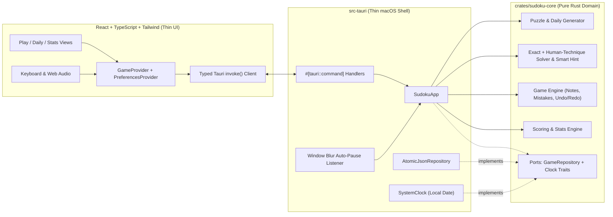

# Offline macOS Sudoku App — Implementation Plan

## Goal Description

Build a fast, visually refined, offline-first macOS desktop Sudoku application using **Tauri v2** ([ADR-0001](./adr/0001-tauri-v2-stack.md)) with a pure, Tauri-agnostic Rust domain crate (`sudoku-core`) and a thin React + TypeScript + Tailwind CSS frontend ([ADR-0002](./adr/0002-rust-owned-domain-engine.md)), keeping the macOS `.app` bundle small (~6–10 MB) and strictly adhering to canonical domain language in [CONTEXT.md](../CONTEXT.md).

Core v1 capabilities:
- **Standard Games** across four human-technique-graded **Difficulties** (`Easy`, `Medium`, `Hard`, `Expert`) with guaranteed unique solutions.
- **Daily Challenge** seeded deterministically offline by local calendar date (`YYYY-MM-DD`) with weekly Difficulty rotation, interactive monthly calendar, catch-up for past dates, and locked future/completed dates.
- **Solving Ergonomics:** **Notes** with automatic peer clearing, **Undo/Redo**, **Erase**, smart row/column/box/digit highlights, and full macOS keyboard + mouse play.
- **Mistakes & Smart Hints:** Instant solution-checked unlimited permanent **Mistakes**; unlimited **Smart Hints** that first flag any existing Mistake or else identify the next logically deducible cell and its solving technique.
- **Scoring & Stats:** `Final Score = max(0, Earned Score + Time Bonus − Penalty)` with single-award cell scoring, per-Difficulty statistics, **Flawless Solves**, **Win Streak**, **Daily Streak**, and Recent History persisted via atomic JSON.
- **macOS Polish:** Light / Dark / System appearance, overlay titlebar, auto-pause with obscured board on pause or window blur, compact resizable window, and toggleable zero-asset Web Audio cues.

---

## Approved Parameters

| Difficulty | Multiplier | Earned Score / Cell | Mistake Penalty | Hint Penalty | Target Solve Time | Max Time Bonus |
| :--- | :---: | :---: | :---: | :---: | :---: | :---: |
| `Easy` | `1.0×` | `+50` | `−100` | `−150` | `5 min` (300s) | `+1,000` |
| `Medium` | `1.5×` | `+75` | `−150` | `−225` | `10 min` (600s) | `+1,500` |
| `Hard` | `2.0×` | `+100` | `−200` | `−300` | `18 min` (1,080s) | `+2,000` |
| `Expert` | `3.0×` | `+150` | `−300` | `−450` | `30 min` (1,800s) | `+3,000` |

- **Time Bonus formula:** Awarded on completion only: `round(max_time_bonus * max(0, target_secs - solve_time_secs) / target_secs)`.
- **Daily Challenge weekly Difficulty schedule:** Mon `Easy`, Tue–Wed `Medium`, Thu–Fri `Hard`, Sat–Sun `Expert`.
- **Frontend package manager:** `pnpm`.

---

## Architecture Overview

---

## Milestones

Each milestone follows TDD and is committed atomically to git once all format, lint, and test gates pass (see [AGENTS.md](../AGENTS.md)).

1. **Milestone 1 — Workspace Scaffold & Tooling Baseline:** Cargo workspace (`crates/sudoku-core`, `src-tauri`), Vite + React 19 + TypeScript + Tailwind CSS v4 + Vitest, `.gitignore`, release size profile.
2. **Milestone 2 — `sudoku-core` Domain Primitives, Board Model & Scoring Engine:** `DomainError`, `CellIndex`, `Digit`, `NotesMask`, `Difficulty`, `GameKind`, `GameStatus`, `DailyDate`, `Puzzle`, `ScoreBreakdown`.
3. **Milestone 3 — Exact Solver, Human-Technique Solver, Smart Hint & Puzzle Generator:** Bitmask MRV uniqueness verifier, human technique ladder (`Easy` → `Expert`), Smart Hint engine (flags existing Mistake first), Standard & deterministic Daily Challenge generators.
4. **Milestone 4 — Game Aggregate, Stats, Persistence Ports & Application Service:** `Game` state machine (permanent Mistakes, single-award Earned Score, Notes auto-clear, Undo/Redo), per-Difficulty Stats, `Win Streak`, `Daily Streak`, `DailyCalendar`, `GameRepository`/`Clock` traits, `SudokuApp<R, C>` enforcing max 1 Standard + 1 Daily active slot.
5. **Milestone 5 — Tauri v2 macOS Shell, Persistence Adapter & IPC Commands:** `AtomicJsonRepository`, `SystemClock`, thin `#[tauri::command]` handlers, macOS overlay titlebar, window blur auto-pause listener.
6. **Milestone 6 — Design System, Typed IPC Client, Web Audio & Core Play View:** Light/Dark/System semantic tokens, zero-asset Web Audio synthesizer, `GameProvider`, `SudokuBoard`, `BoardCell`, `PauseVeil`, `HintBanner`, `ControlBar`, `NumberPad`, `NewGameDialog`, `VictorySummary`, full macOS keyboard ergonomics.
7. **Milestone 7 — Daily Challenge Calendar View & Stats Dashboard:** Interactive monthly calendar with catch-up & locked states, per-Difficulty Stats dashboard, Recent History list.
8. **Milestone 8 — macOS Release Build, Bundle Size Audit & Final Polish:** `pnpm tauri build --bundles app`, bundle size measurement (~6–10 MB target), end-to-end verification.

---

## Verification Gates

- **Rust:** `cargo fmt --all -- --check`, `cargo clippy --workspace --all-targets -- -D warnings`, `cargo test --workspace`
- **Frontend:** `pnpm typecheck`, `pnpm test`, `pnpm build`
- **macOS Bundle:** `pnpm tauri build --bundles app` and `du -sh src-tauri/target/release/bundle/macos/*.app`
